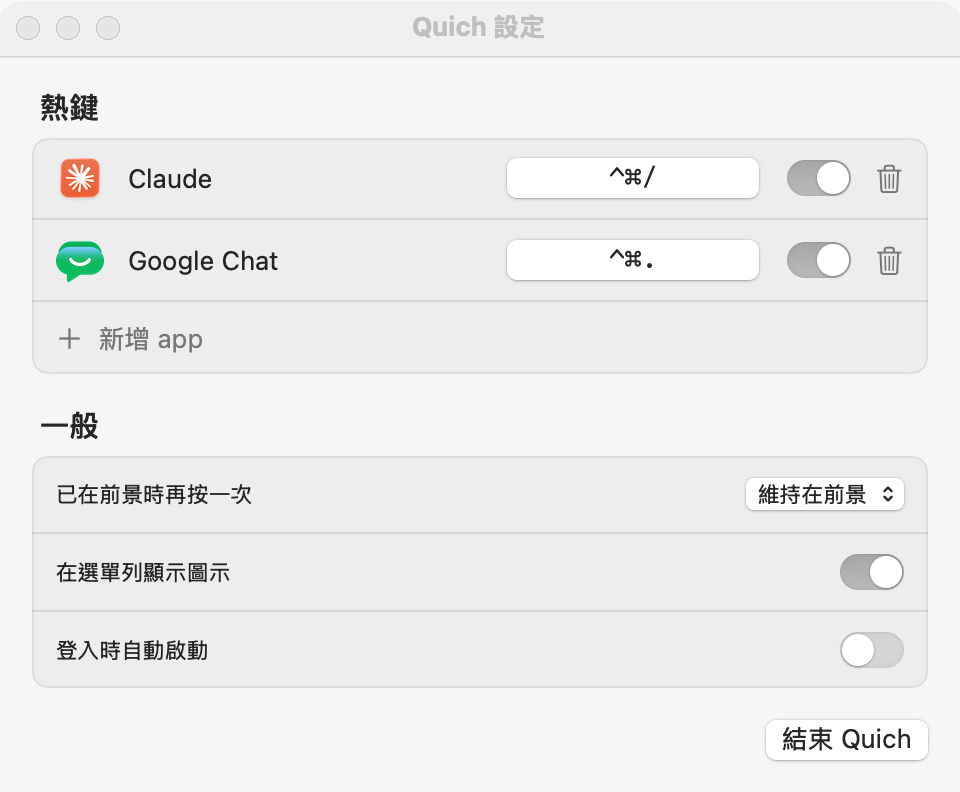

<p align="center">
  
</p>

# Quich

Quick + Launch。住在 Mac 選單列的小工具，按一組熱鍵就打開你指定的 app。不管現在停在哪個 app，熱鍵都有效。

## 功能

- **一鍵打開 app**：替常用的 app 各設一組熱鍵，按下就打開或切到前景；每組熱鍵都能單獨開關
- **再按一次的行為**：app 已經在前景時再按一次，可以選擇「維持在前景」或「隱藏」
- **安靜地待在背景**：可以從選單列暫停所有熱鍵，也可以把選單列圖示整個隱藏
- **登入時自動啟動**

<picture>
  <source media="(prefers-color-scheme: dark)" srcset="docs/images/settings-dark.png">
  
</picture>

## 下載與安裝

需要 macOS 13 以上、Apple 晶片（M 系列）的 Mac。

1. 到 [Releases](https://github.com/DivaDebug/Quich/releases/latest) 下載最新版的 `Quich.zip`
2. 解壓縮後，把 `Quich.app` 拖進「應用程式」資料夾
3. 打開 Quich

### 第一次打開時被 macOS 擋下來？

Quich 沒有經過 Apple 認證簽章，所以第一次打開時，macOS 會跳出「未打開 Quich」的警告。這不是 app 壞掉，照下面步驟允許一次就好：

1. 在警告視窗按「完成」
2. 打開「系統設定 → 隱私權與安全性」，往下捲到「安全性」
3. 找到「已阻擋 Quich」那一行，按「仍要打開」
4. 接著跳出的確認視窗也按「仍要打開」，再輸入 Mac 的密碼或使用 Touch ID

之後就能正常打開，不會再跳出警告。

## 自行建置

需要 macOS 13 以上與 Xcode（或 Command Line Tools）。

```bash
./scripts/build-app.sh            # 只建立 build/Quich.app
./scripts/build-app.sh --install  # 建立後複製到 /Applications 並啟動
```
